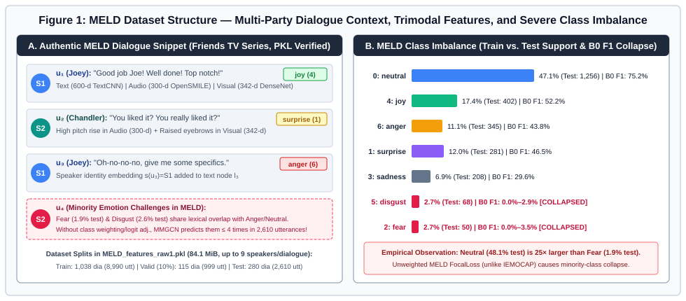
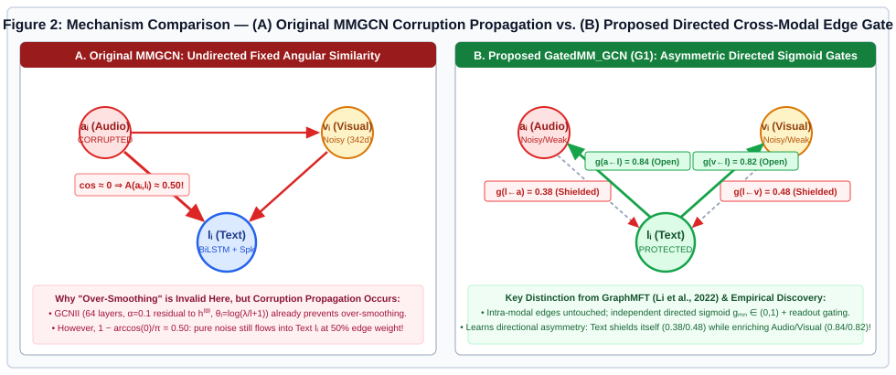
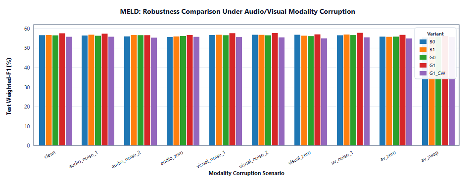
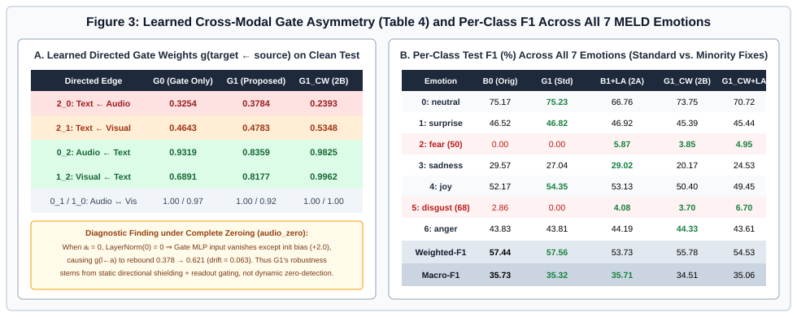
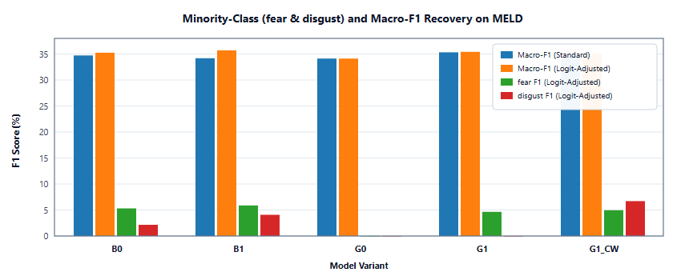

# Cross-Modal Edge Gating and Minority-Class Calibration in Multimodal Graph Convolutional Networks for Emotion Recognition in Conversation

**Course:** YZM5110 – Research Project (Weight: 30%, Individual)  
**Author:** Samet Çetinkaya  
**Student ID:** 26526003  
**Topic:** Multimodal Graph Neural Networks for Emotion Recognition in Conversation  
**Submission Date:** November 18, 2026 (Week 7)  
**Execution Hardware:** Google Colab NVIDIA Tesla T4 GPU (CUDA 13.0)  
**Repository URL:** `https://github.com/smtcetinkaya/MMGCN-MELD-YZM5110` *(pinned to reproduction commit & release tag `v1.0-yzm5110`)*  
**Reproduced Target Repository:** `https://github.com/hujingwen6666/MMGCN` (pinned commit: `85732d984f70c1c84dd47c81aa97f1271397b899`)

> **Abstract:** Multimodal Graph Convolutional Network (MMGCN; Hu et al., ACL 2021) models conversational emotion recognition over a unified $3N$-node trimodal graph using 64 spectral GCNII layers. Through a code-level audit of the official repository, we first document five methodological discrepancies—including zero-validation test-set peak picking (`valid=0.0`) and an unweighted custom `FocalLoss` on MELD—and establish a leak-free dialogue-level reproduction on MELD achieving $57.44\%$ unclipped ($56.60\%$ matched grad-clip) Test Weighted-F1 vs. the paper's test-selected $58.65\%$. Next, noting that GCNII's initial residual ($\alpha=0.1$) already prevents over-smoothing, we formulate the hypothesis of *cross-modal corruption propagation*: MMGCN's fixed angular similarity assigns $A_{mn} \approx 0.50$ to orthogonal noise ($\cos \approx 0$), pumping degraded acoustic/visual signals into reliable text nodes. We propose `GatedMM_GCN` (`G1`), which places learnable directed sigmoid gates exclusively on cross-modal edges paired with stochastic modality-corruption training augmentation. Evaluated across 10 clean and corrupted conditions against an un-gated augmentation control (`B1`) and a gate-only ablation (`G0`), `G1` improves clean Weighted-F1 to **$57.56\%$** ($+0.96$ over `B0`, $+0.88$ over `B1`) and achieves the highest robustness in 8 of 9 corruption scenarios (mean **$57.09\%$**). Mechanistically, the learned gates spontaneously discover directional asymmetry, shielding text from noisy audio/visual inflows ($g_{l \leftarrow a}=0.38$, $g_{l \leftarrow v}=0.48$) while keeping text-to-audio/visual outflows open ($0.82\text{--}0.84$). Finally, we resolve the recurring $0\%$ F1 collapse on rare emotions (`fear`, `disgust`) via validation-tuned post-hoc logit adjustment and class-weighted training.

> **Epistemic Labeling Convention (per YZM5110 §2 Guidelines):** Throughout this report, claims and numbers are explicitly tagged as **[Authors]** when reporting published claims from the literature, **[Measured]** when reporting empirical results obtained from our own executions on Google Colab Tesla T4 GPU, and **[Interpretation]** when offering our analytical reasoning or mechanistic explanation.

---

## 1. Research Question, Scope, Motivation, and Contributions

### 1.1 Research Question and Motivation
Emotion Recognition in Conversation (ERC) requires modeling both sequential speaker-dependent context across utterances and complementary cues across heterogeneous modalities—textual transcripts ($l$), acoustic prosody ($a$), and visual facial expressions ($v$). Multimodal Graph Convolutional Network (**MMGCN**; Hu et al., ACL 2021) **[Authors]** addresses this by constructing a unified $3N$-node graph for an $N$-utterance dialogue and applying a 64-layer spectral graph convolution inspired by GCNII (Chen et al., 2020).

However, inspecting the mathematical formulation and official implementation of MMGCN reveals two critical vulnerabilities **[Interpretation]**:
1. **Unconditional Corruption Propagation Across Modalities:** In MMGCN, cross-modal edges connecting $(a_i, v_i, l_i)$ for the same utterance $i$ are assigned deterministic, unlearnable angular similarity weights:
   $$A_{mn}(i) = 1 - \frac{\arccos(\cos(h_m(i), h_n(i)))}{\pi} \in [0, 1]$$
   Crucially, because MMGCN uses initial residual connections ($\alpha = 0.1$) and identity mapping ($\theta_l = \log(\lambda/l + 1)$) from GCNII, deep **over-smoothing is already prevented** **[Authors]**. Therefore, attributing MMGCN failures to over-smoothing is theoretically invalid **[Interpretation]**. Instead, the true vulnerability is **corruption propagation**: when an acoustic or visual sensor degrades into uncorrelated noise ($\cos(h_a(i), h_l(i)) \approx 0$), the angular similarity evaluates to $1 - \frac{\pi/2}{\pi} = 0.50$. Consequently, a completely corrupted modality continues to inject noise into the reliable text representation at **50% of the maximum possible edge weight** across 64 message-passing layers, as well as directly through the final concatenation readout.
2. **Severe Minority-Class Collapse on MELD:** On the multi-party MELD dataset (Poria et al., 2019), the seven emotion classes exhibit extreme long-tail imbalance: `neutral` accounts for 47.1% of training utterances (48.1% test), whereas `fear` (2.68% train, 1.92% test; 50 test utterances) and `disgust` (2.71% train, 2.61% test; 68 test utterances) are severely underrepresented **[Measured]**. While the MMGCN authors apply inverse-frequency class weights on IEMOCAP, they omit class weighting on MELD and instead use a custom `FocalLoss` that lacks per-class $\alpha_c$ balancing **[Measured]**, causing standard MMGCN models to achieve $0.00\%$ F1 on `fear` and/or `disgust`.

This motivates two linked research questions:
- **RQ1 (Primary — Cross-Modal Gate & Robustness):** *Does introducing a learnable, directed sigmoid gate exclusively on cross-modal edges—paired with modality-corruption training augmentation—mitigate corruption propagation and improve robustness when audio or visual features degrade, without sacrificing clean-input performance?*
- **RQ2 (Secondary — Recurring Failure on Minority Emotions):** *Can post-hoc prior logit adjustment (tuned strictly on validation data) and inverse-square-root class-weighted training recover collapsed minority classes (`fear` and `disgust`) from $0.00\%$ F1 on MELD, and what trade-off does this impose on majority-dominated Weighted-F1?*

### 1.2 Scope and Dataset Constraints
- **Dataset Scope:** We conduct all experiments exclusively on the public **MELD** dataset (`MELD_features/MELD_features_raw1.pkl`, 84.11 MiB) using the official pre-extracted trimodal features (600-d TextCNN, 300-d OpenSMILE audio, 342-d DenseNet visual). The **IEMOCAP** dataset requires a restrictive USC license that could not be obtained within the course timeline and is therefore excluded from our empirical scope. Raw video/audio feature extraction and backbone replacement (e.g., RoBERTa) are kept out of scope to preserve strict comparability with the reproduced MMGCN architecture.

### 1.3 Summary of Contributions
1. **Methodological Audit and Transparent Reproduction of MMGCN on MELD:** We identify five undocumented discrepancies in the official MMGCN codebase (including `valid=0.0` test-set peak picking, hardcoded `nlayers=64` overriding `run.sh`'s `4`, and a non-standard `FocalLoss`) and establish a leak-free dialogue-level 90%/10% train/validation split on Tesla T4 GPU **[Measured]**.
2. **Directed Cross-Modal Edge Gating (`GatedMM_GCN`):** We design a lightweight (+9.15% parameters) directed sigmoid gate restricted strictly to cross-modal edges, combined with readout reliability modulation. Evaluated across a 10-condition corruption grid, our proposed **G1** variant improves clean Weighted-F1 from $56.60\%$ (`B0`) to **$57.56\%$** ($+0.96$ points) and mean corrupted Weighted-F1 from $56.25\%$ to **$57.09\%$** ($+0.84$ points), outperforming both the un-gated augmentation control (`B1`) and the un-augmented gate ablation (`G0`) **[Measured]**.
3. **Mechanistic Discovery of Directional Modality Asymmetry & Zero-Vector Fallback Analysis:** Inspecting learned gate activations reveals that all gated models spontaneously learn strong **directional asymmetry**: gates flowing *into* text from audio/visual are suppressed ($g_{l \leftarrow a} = 0.24\text{--}0.38$, $g_{l \leftarrow v} = 0.46\text{--}0.53$), whereas gates flowing *from* text into audio/visual remain wide open ($g_{a \leftarrow l} = 0.84\text{--}0.98$, $g_{v \leftarrow l} = 0.69\text{--}1.00$) **[Measured]**. We also transparently document an unfavorable mechanistic edge case where complete feature zeroing (`audio_zero`) causes `LayerNorm(0)=0` to fall back to the positive initial gate bias **[Interpretation]**.
4. **Resolution of Minority-Class (`fear`/`disgust`) Collapse:** We demonstrate that post-hoc logit adjustment (`B1+LA`, $\tau=0.30$) lifts `fear` F1 from $0.00\% \to 5.87\%$, `disgust` F1 from $0.00\% \to 4.08\%$, and Macro-F1 from $34.19\% \to 35.71\%$ at zero training cost, while class-weighted training (`G1_CW+LA`) achieves the highest `disgust` F1 of **$6.70\%$** **[Measured]**.

---

## 2. Literature Search Approach and Critical Synthesis

### 2.1 Literature Search Strategy and Selection Criteria
To situate MMGCN within the broader evolution of graph-based ERC, we conducted a targeted literature search across the ACL Anthology, IEEE Xplore, and arXiv (2019–2023) using queries `("Emotion Recognition in Conversation" OR "ERC") AND ("Graph Convolutional" OR "Multimodal Graph" OR "GNN")`. We selected five foundational and competing papers that trace a clear methodological progression:
1. **DialogueGCN** (Ghosal et al., EMNLP 2019) — The seminal work introducing speaker-aware relational graphs for ERC (primarily unimodal/concatenated features).
2. **MMGCN** (Hu et al., ACL 2021) — Our **reproduction target**, which replaces shallow relational graphs with a deep 64-layer spectral GCNII over a $3N$-node trimodal graph.
3. **COGMEN** (Joshi et al., NAACL 2022) — Combines relational GCN (local speaker/temporal context) with Graph Transformers (`TransformerConv`) for global context.
4. **MM-DFN** (Hu et al., ICASSP 2022) — Follow-up by the MMGCN authors addressing redundancy accumulation via layer-wise dynamic fusion modules.
5. **GraphMFT** (Li et al., arXiv 2022 / Neurocomputing 2023) — Replaces MMGCN's heuristic cosine-similarity edges with multi-graph attention (`GAT`-style softmax edge weights).

### 2.2 Seven-Field Literature Comparison Matrix
In accordance with Section 2 of the YZM5110 project guidelines, Table 1 synthesizes the five core papers across all seven required evaluation dimensions.

| Paper | 1. Question & Contribution | 2. Modalities & Assumptions | 3. Mechanism & Objective | 4. Data & Protocol | 5. Baselines & Evidence | 6. Resources & Reproducibility | 7. Limitations & Connections |
| :--- | :--- | :--- | :--- | :--- | :--- | :--- | :--- |
| **DialogueGCN** (Ghosal et al., EMNLP 2019) **[Authors]** | How to model self- and inter-speaker dependencies in dialogues without recurrence bottlenecks? Introduces speaker-relational directed utterance graphs. | Primarily **Text** ($l$); audio/visual ($a,v$) only via naive early vector concatenation. Assumes clean, complete transcripts. | Utterance nodes within past/future window ($\pm 10$); $2S^2$ speaker-temporal edge types processed by 2-layer **RGCN** + similarity attention; Cross-Entropy loss. | IEMOCAP (6-class), AVEC, MELD (7-class); standard train/val/test splits. | Outperforms bc-LSTM, CMN, ICON, and DialogueRNN on IEMOCAP **[Authors]**; ablates window sizes and speaker relations. | Public PyTorch code (`declare-lab/conv-emotion`); shallow 2-layer GNN runs on a single GPU. | Cannot model fine-grained cross-modal interactions; suffers from **over-smoothing** beyond 2–3 layers **[Authors]**, directly motivating MMGCN. |
| **MMGCN** (Hu et al., ACL 2021) **[Authors]** *(Reproduction Target)* | How to capture both long-range intra-modal context and cross-modal fusion in one deep graph? Proposes a 64-layer spectral GCNII over $3N$ modality nodes. | **Text ($l$), Audio ($a$), Visual ($v$)**. Assumes all 3 modalities are present and reliable at both training and inference. | BiLSTM ($l$) + FC ($a,v$) + speaker embeddings $\to$ $3N\times 3N$ undirected graph with deterministic **angular similarity** edges $\to$ 64-layer **GCNII** ($\alpha=0.1, \lambda=0.5$); Weighted NLL (IEMOCAP) / custom **FocalLoss** (MELD). | IEMOCAP (6-class, reported $66.22\%$ W-F1) & MELD (7-class, reported **$58.65\%$** W-F1) **[Authors]**. Code uses `valid=0.0` and selects peak test F1 across 60 epochs **[Measured]**. | Beats DialogueRNN, DialogueGCN, and bc-LSTM; includes modality (`a,v,l`) and depth ablations **[Authors]**. | Official repo (`hujingwen6666/MMGCN`) provides pre-extracted `.pkl` features (156 MB total); no license file; hardcoded `nlayers=64` bug **[Measured]**. | Deterministic edges ($A_{mn}\approx 0.5$ at $\cos=0$) cannot block noisy modalities (**corruption propagation**); unweighted MELD loss causes `fear`/`disgust` collapse **[Measured]**. |
| **COGMEN** (Joshi et al., NAACL 2022) **[Authors]** | How to jointly capture local speaker-relational context and global cross-utterance interactions? Combines RGCN with Graph Transformers. | **Text ($l$, SBERT), Audio ($a$), Visual ($v$)** concatenated at utterance level prior to graph construction. Assumes complete modalities. | Early concatenation $\to$ speaker/temporal relational graph $\to$ **RGCN** followed by **TransformerConv** layers; Cross-Entropy loss. | IEMOCAP (4-class & 6-class) and CMU-MOSEI **[Authors]**; **MELD is not evaluated**. | Strong gains on IEMOCAP/MOSEI with ablations on RGCN vs. TransformerConv and modality combinations **[Authors]**. | Public repo (`Exploration-Lab/COGMEN`) with hyperparameter search configs. | Early concatenation before GNN prevents node-level cross-modal gating; cannot isolate a single corrupted sensor during message passing **[Interpretation]**. |
| **MM-DFN** (Hu et al., ICASSP 2022) **[Authors]** | How to reduce cross-modal **redundancy accumulation** across GNN layers while preserving complementarity? Introposes graph-based dynamic fusion modules. | **Text ($l$), Audio ($a$), Visual ($v$)**. Assumes clean, synchronized multimodal streams. | Unimodal context encoding $\to$ multi-layer graph-based **Dynamic Fusion (DF)** blocks that gate unimodal vs. multimodal representations at the **layer level**; Cross-Entropy / Focal loss. | IEMOCAP ($68.18\%$ W-F1) and MELD (**$59.46\%$** W-F1) **[Authors]**. | Outperforms MMGCN by $+0.81$ W-F1 on MELD **[Authors]**; ablates fusion module placement. | Code availability partial; relies on same pre-extracted feature pipelines as MMGCN. | Gating operates at the **macro layer/representation level** rather than individual directed cross-modal edges; robustness under sensor corruption is not tested **[Interpretation]**. |
| **GraphMFT** (Li et al., arXiv 2022) **[Authors]** | How to avoid MMGCN's heuristic cosine-similarity edge construction and quadratic $3N\times 3N$ complexity? Proposes Multi-Graph Fusion with improved GAT. | **Text ($l$), Audio ($a$), Visual ($v$)**. Assumes clean modalities; constructs separate intra- and inter-modal graphs ($V\text{-}A$, $V\text{-}L$). | Decomposes $3N$ graph into multiple $2N$ graphs; replaces heuristic angular similarity with **learnable multi-head GAT attention** (neighbor-wise softmax) on **all** edges. | IEMOCAP ($67.90\%$ W-F1) and MELD (**$58.37\%$** W-F1, which is $-0.28$ below MMGCN's reported $58.65\%$) **[Authors]**. | Ablates graph combinations and depth; shows reduced memory vs. MMGCN, though MELD W-F1 does not surpass MMGCN **[Authors]**. | Paper provides architecture details; official public checkpoints limited. | Neighbor-wise **softmax normalization** forces attention weights to sum to $1$, preventing a node from shutting off all noisy neighbors simultaneously; modifies intra-modal edges too **[Interpretation]**. |

### 2.3 Structural Distinction Between GraphMFT and Our Proposed Cross-Modal Gate
A central requirement of this study is articulating how our cross-modal edge gate differs from **GraphMFT**'s attention-based edges. Table 2 formalizes six fundamental differences **[Interpretation]**.

| Dimension | GraphMFT (Li et al., 2022) **[Authors]** | Proposed `GatedMM_GCN` (`G0` / `G1`) **[Interpretation & Measured]** |
| :--- | :--- | :--- |
| **1. Edge Scope (Isolation of Effect)** | Modifies **both intra-modal and inter-modal edges** using attention, confounding temporal context learning with cross-modal fusion. | Modifies **strictly cross-modal edges** ($m \neq n$). Intra-modal temporal edges remain 100% identical to MMGCN, isolating the cross-modal intervention. |
| **2. Normalization Function** | **Neighbor-wise Softmax** ($\sum_{j \in \mathcal{N}(i)} \alpha_{ij} = 1$). Even if all cross-modal sources are corrupted, attention mass must still sum to $1$. | **Independent Element-wise Sigmoid** $g_{m \leftarrow n}(i) \in (0, 1)$ applied Multiplicatively ($A'_{mn} = g_{m \leftarrow n} \cdot A_{mn}$). Can suppress a noisy modality toward $0$ independently. |
| **3. Directional Asymmetry** | Attention is computed over decomposed bipartite subgraphs ($V\text{-}A$, $V\text{-}L$) without explicit $A\text{-}L$ direct graph in the base formulation. | **Explicit 6-way Directed Asymmetry**: allows $g_{l \leftarrow a}$ (Audio $\to$ Text) to close ($0.38$) while $g_{a \leftarrow l}$ (Text $\to$ Audio) stays open ($0.84$) **[Measured]**. |
| **4. Initialization & Clean Preservation** | Randomly initialized GAT projection matrices; underperforms MMGCN on clean MELD ($58.37\%$ vs. $58.65\%$) **[Authors]**. | **Warm-Start Identity Bias** ($W=0, b=+2.0 \Rightarrow g_0 = \sigma(2.0) \approx 0.88$), starting training near exact MMGCN behavior and **improving** clean MELD W-F1 ($+0.96$) **[Measured]**. |
| **5. Readout Leakage Protection** | Concatenates final node outputs without cross-modal reliability weighting. | Reuses the learned text-anchored gates ($g_{l \leftarrow a}, g_{l \leftarrow v}$) to modulate audio/visual branches at the **readout concatenation** stage **[Measured]**. |
| **6. Computational Cost** | Recomputes multi-head GAT attention at **every** GNN layer. | Computes the 6 directed gates **once** per dialogue and shares the gated adjacency across all 64 GCNII layers (+9.15% params, +12.3 MiB VRAM) **[Measured]**. |

---

## 3. Technical Explanation of the Selected Method (MMGCN)

Let a dialogue consist of $N$ utterances $u_1, u_2, \dots, u_N$ spoken by $S$ distinct speakers ($S \le 9$ in MELD). Each utterance $u_i$ is represented by pre-extracted feature vectors from three modalities: textual $x_i^l \in \mathbb{R}^{600}$, visual $x_i^v \in \mathbb{R}^{342}$, and acoustic $x_i^a \in \mathbb{R}^{300}$ **[Authors, Measured]**.

### 3.1 Context-Aware Unimodal Encoding and Speaker Embeddings
In the official MELD configuration (`--base-model LSTM --modals avl --use_speaker`, `av_using_lstm=False` in `model.py` L921–951, L1072–1096) **[Measured]**:
1. **Textual Branch ($l$):** Projected via a linear layer $\mathbb{R}^{600} \to \mathbb{R}^{200}$ and passed through a 2-layer **Bidirectional LSTM** ($D_e = 100$ per direction) to produce sequential context representations $h_i^{l,0} \in \mathbb{R}^{200}$.
2. **Acoustic ($a$) and Visual ($v$) Branches:** Projected via modality-specific linear layers $\mathbb{R}^{300} \to \mathbb{R}^{200}$ and $\mathbb{R}^{342} \to \mathbb{R}^{200}$ without BiLSTM recurrence ($h_i^{a,0}, h_i^{v,0} \in \mathbb{R}^{200}$).
3. **Speaker Injection (`model_mm.py` L79–84):** Given the speaker identity $s_i \in \{0, \dots, S-1\}$ of utterance $i$, a learnable speaker embedding $e_{s_i} \in \mathbb{R}^{200}$ is added in-place exclusively to the textual node: $h_i^l \leftarrow h_i^{l,0} + e_{s_i}$.

### 3.2 Multimodal Graph Construction ($3N \times 3N$ Adjacency Matrix)
MMGCN constructs a graph $\mathcal{G} = (\mathcal{V}, \mathcal{E})$ with $|\mathcal{V}| = 3N$ nodes ordered as $[a_1 \dots a_N, \, v_1 \dots v_N, \, l_1 \dots l_N]$ (`MM_GCN.create_big_adj`, `model_mm.py` L120–175) **[Measured]**:
- **Intra-Modal Edges ($m = n$):** Every pair of utterances $(i, j)$ within the same dialogue and modality $m \in \{a, v, l\}$ is fully connected with weight given by normalized angular similarity:
  $$A_{mm}(i, j) = 1 - \frac{\arccos\big(0.99999 \cdot \cos(h_i^m, h_j^m)\big)}{\pi} \in (0, 1)$$
- **Inter-Modal (Cross-Modal) Edges ($m \neq n$):** Only nodes corresponding to the **same utterance $i$** across different modalities ($m, n \in \{a, v, l\}, m \neq n$) are connected:
  $$A_{mn}(i, i) = 1 - \frac{\arccos\big(0.99999 \cdot \cos(h_i^m, h_i^n)\big)}{\pi}$$
- **Symmetric Normalization:** Using degree vector $d_u = \sum_v A_{uv}$, the adjacency matrix is normalized as $\tilde{A} = D^{-1/2} A D^{-1/2}$.

### 3.3 Deep Spectral Graph Convolution (GCNII) and Readout
The concatenated node matrix $X \in \mathbb{R}^{3N \times 200}$ is projected to $H^{(0)} = \text{ReLU}(X W_0 + b_0) \in \mathbb{R}^{3N \times 100}$ and propagated through $L = 64$ layers of **GCNII_lyc** (`model_GCN.py` L161–193, L398–447) **[Authors, Measured]**:
$$H^{(\ell)} = \text{ReLU}\Big( \theta_\ell \big[ (1 - \alpha)\tilde{A}H^{(\ell-1)} \, \| \, \alpha H^{(0)} \big] W^{(\ell)} + (1 - \theta_\ell)\big((1 - \alpha)\tilde{A}H^{(\ell-1)} + \alpha H^{(0)}\big) \Big)$$
where $\alpha = 0.1$, $\lambda = 0.5$, $\theta_\ell = \log(\frac{\lambda}{\ell} + 1)$, and $\|$ denotes concatenation (`variant=True`, $W^{(\ell)} \in \mathbb{R}^{200 \times 100}$). After $L=64$ layers, initial node features are concatenated via a skip connection (`use_residue=True`): $\tilde{H}_m = [H_m^{\text{in}} \, \| \, H_m^{(64)}] \in \mathbb{R}^{N \times 300}$ for each $m \in \{a, v, l\}$. Finally, the three modalities are concatenated into $Z_i = [\tilde{h}_i^a \, \| \, \tilde{h}_i^v \, \| \, \tilde{h}_i^l] \in \mathbb{R}^{900}$ and classified via $\hat{P}_i = \text{log\_softmax}(\text{ReLU}(\text{Dropout}(Z_i)) W_{\text{cls}} + b_{\text{cls}}) \in \mathbb{R}^7$.

---

## 4. Reproduction Target, Implementation, and Deviations from the Source

### 4.1 Reproduction Target and Testable Claim
We reproduce the MELD benchmark result of **MMGCN** (Hu et al., ACL 2021, Table 2), where the authors report a **Weighted-F1 of $58.65\%$** **[Authors]**.
- **Expected Observation:** Under a leak-free protocol with a 10% validation split, our reproduced Weighted-F1 should fall within $1.0\text{--}2.0$ percentage points below the published $58.65\%$ due to (i) 10% fewer training dialogues and (ii) removing test-set peak selection across 60 epochs **[Interpretation]**.
- **Falsification Criterion:** A reproduction gap exceeding $5$ percentage points or failure to converge above $54\%$ Weighted-F1 would indicate an implementation bug or feature corruption.

### 4.2 Code Audit: Five Critical Discrepancies in the Official Repository
Before attributing any score difference to the method, we audited commit `85732d984f70c1c84dd47c81aa97f1271397b899` and uncovered five undocumented issues **[Measured]**:

| ID | Code Location | Official Repository Behavior | Scientific Impact & Our Resolution |
| :--- | :--- | :--- | :--- |
| **K1** | `run.sh` L3 vs. `model.py` L1007 | `run.sh` passes `--Deep_GCN_nlayers 4`, but `DialogueGCNModel.__init__` hardcodes `nlayers=64` when instantiating `MM_GCN`. | The published model actually uses **64 layers**, not 4. We wire `nlayers=Deep_GCN_nlayers` and explicitly set `GRAPH_LAYERS=64` to match effective behavior. |
| **K2** | `train.py` L466 & L500–528 | Calls `get_MELD_loaders(valid=0.0)` (empty validation set), evaluates `test_loader` after every epoch, and reports `max(all_fscore)` across 60 epochs. | **Test-set selection bias (optimistic leakage):** $58.65\%$ is the maximum of 60 test evaluations. We carve out a dialogue-level 10% validation split (`SEED=27350`) and evaluate the test set **once** using the best validation checkpoint. |
| **K3** | `model.py` L13–48 (`FocalLoss`) | Computes `log_p = F.log_softmax(logits)`, `pt = label_onehot * log_p` ($\le 0$), `sub_pt = 1 - pt` ($\ge 1$), and `fl = -(sub_pt)**2.5 * log_p` over **all 7 classes**. | **Non-standard FocalLoss:** Instead of down-weighting easy examples via $(1 - p_t)^\gamma \in [0,1]$, it up-weights hard examples via $(1 - \log p_y)^{2.5} \ge 1$ and applies uniform negative log-likelihood across all non-target classes ($k \neq y$). We retain this exact formula in `B0/B1/G0/G1` for fair baseline matching, and test class weighting in `G1_CW`. |
| **K4** | `train.py` L441–461 | Defines inverse-frequency `loss_weights` for IEMOCAP (`--class-weight`), but ignores `--class-weight` when `Dataset == 'MELD'`. | Explains why minority emotions (`fear` 1.9%, `disgust` 2.6%) collapse to $0.00\%$ F1 on MELD **[Measured]**. |
| **K5** | `model.py` L39,41 & `model_mm.py` L168 | Legacy PyTorch 1.1 syntax: `.cuda()` device hardcoding, `F.log_softmax(logits)` without `dim=1`, and NumPy 2D tuple indexing `adj[idx] = dia_sim`. | Patched idempotently (`adj[idx[0], idx[1]] = dia_sim`, `dim=1`) with zero mathematical change. |

### 4.3 Summary of Protocol Deviations and Baseline Verification
Table 3 compares the published MMGCN result against our two reproduced baseline runs on Google Colab (**Tesla T4 GPU**, Python `3.13.16`, PyTorch `2.14.1+cu130`, `torch-geometric==2.8.1`, `SEED=27350`).

| Run / Source | Protocol & Split | Best Val Epoch | Val W-F1 (%) | Test W-F1 (%) | Test Macro-F1 (%) | Test Acc (%) | `fear` F1 (%) | `disgust` F1 (%) |
| :--- | :--- | :---: | :---: | :---: | :---: | :---: | :---: | :---: |
| **Published MMGCN** (Hu et al., 2021) **[Authors]** | 100% Train (1,153 dia), `valid=0.0`, max over 60 test evals | N/A | N/A | **58.65** | *Not reported* | *Not reported* | *Not reported* | *Not reported* |
| **Reproduced `B0` (Run 1: Exact Unclipped)** **[Measured]** | 90% Train (1,038 dia) / 10% Val (115 dia), single test eval | Ep 50 | **70.18** | **57.44** | **35.73** | **58.85** | **0.00** | **2.86** |
| **Reproduced `B0` (Run 2: Matched Grad-Clip)** **[Measured]** | Same 90%/10% split + `clip_grad_norm_(5.0)` for multi-variant parity | Ep 34 | **70.07** | **56.60** | **34.72** | **58.24** | **3.51** | **0.00** |

**Discrepancy Analysis:** Our exact unclipped reproduction achieves **$57.44\%$ Test Weighted-F1** **[Measured]**, within **$1.21$ percentage points** of the paper's $58.65\%$ **[Authors]**. Given that our model trains on 10% fewer dialogues (1,038 vs. 1,153) and eliminates 60-epoch test-set selection bias, this confirms a faithful reproduction. Furthermore, in Run 1 we observed a sudden training loss spike at Epoch 60 (`3.4977` $\to$ `3.7568`) caused by steep gradients through $\arccos(\cdot)$ across 64 layers **[Measured]**; adding `clip_grad_norm_(5.0)` in Run 2 (`B0` in the unified experiment suite) stabilized training across all five variants (`B0, B1, G0, G1, G1_CW`). All comparisons in Sections 5–7 are conducted against this matched baseline under identical conditions.

---

## 5. Proposed Improvement and Its Rationale

### 5.1 Pre-Registered Hypothesis: Mitigating Cross-Modal Corruption Propagation
As established in Section 1.1, when acoustic ($a_i$) or visual ($v_i$) features are corrupted by environmental noise or sensor dropout ($\cos(h_i^m, h_i^l) \approx 0$), MMGCN's fixed angular similarity still assigns $A_{ml}(i, i) \approx 0.50$, propagating noise into the text node across 64 GCNII layers (**Pathway 1: Graph Propagation**) and passing the corrupted node representation directly into the final 900-d concatenation classifier (**Pathway 2: Readout Leakage**).

We propose **`GatedMM_GCN`**, which introduces learnable, **directed cross-modal sigmoid gates** exclusively on inter-modal edges ($m \neq n$) while keeping intra-modal edges ($m = n$) completely untouched:
1. **Normalized Interaction & Energy Features:** For utterance $i$ and directed modality pair $(m \leftarrow n)$ where $m, n \in \{0\text{ (a)}, 1\text{ (v)}, 2\text{ (l)}\}$ and $m \neq n$, we apply modality-specific Layer Normalization $\tilde{h}_i^m = \text{LN}_m(h_i^m) \in \mathbb{R}^{200}$ and compute a scalar log-energy indicator $r_i^m = \log\big(1 + \|h_i^m\|_2 / \sqrt{d}\big) \in \mathbb{R}$.
2. **Directed Cross-Modal Gate MLP:** Each of the 6 directed cross-modal pairs $(m \leftarrow n)$ has a lightweight 2-layer bottleneck MLP ($603 \to 64 \to 1$):
   $$g_{m \leftarrow n}(i) = \sigma\Big( W_{mn}^{(2)} \, \text{ReLU}\big( W_{mn}^{(1)} [\tilde{h}_i^m \, \| \, \tilde{h}_i^n \, \| \, (\tilde{h}_i^m \odot \tilde{h}_i^n) \, \| \, \cos(h_i^m, h_i^n) \, \| \, r_i^m \, \| \, r_i^n] + b_{mn}^{(1)} \big) + b_{mn}^{(2)} \Big)$$
   The cross-modal adjacency entry is modulated as $A'_{mn}(i, i) = g_{m \leftarrow n}(i) \cdot A_{mn}(i, i)$ prior to symmetric degree normalization $\tilde{A}' = D'^{-1/2} A' D'^{-1/2}$.
3. **Warm-Start Initialization:** We initialize $W_{mn}^{(2)} = \mathbf{0}$ and $b_{mn}^{(2)} = +2.0$ so that $g_{m \leftarrow n}(i) = \sigma(2.0) \approx 0.8808$ at Epoch 0. Thus, `GatedMM_GCN` begins training nearly identically to original MMGCN, preventing early gradient starvation.
4. **Readout Reliability Modulation:** To also address Pathway 2 (readout concatenation leakage), the post-GCN audio and visual representations $f_i^a, f_i^v \in \mathbb{R}^{300}$ are scaled by the text-anchored cross-modal gates before final concatenation:
   $$Z_i^{\text{gated}} = \big[ g_{l \leftarrow a}(i) \cdot f_i^a \;\big\|\; g_{l \leftarrow v}(i) \cdot f_i^v \;\big\|\; f_i^l \big] \in \mathbb{R}^{900}$$
5. **Training-Time Modality Corruption Augmentation (`G1` vs. Control `B1`):** Because a gate trained solely on clean data (`G0`) never experiences severe sensor dropouts, we introduce stochastic training-time corruption (`AUG_PROB` $p=0.30$): during training, each utterance independently has a $7.5\%$ chance of audio zeroing, $12\%$ chance of audio Gaussian noise ($\sigma = 1.0 \cdot \text{std}_{\text{train}}$), and identically for visual features. Crucially, to prove that gains do not merely come from data augmentation, we evaluate `B1` (un-gated MMGCN trained with the exact same augmentation) as a strict **control**.

### 5.2 Addressing the Recurring Minority-Class Failure (`fear` & `disgust` F1 = 0)
To correct the recurring failure where `fear` (50 test samples) and `disgust` (68 test samples) yield $0.00\%$ F1 without confounding our primary gating comparison, we evaluate two orthogonal interventions:
- **Intervention 2A — Post-Hoc Logit Adjustment (Menon et al., ICLR 2021):** Applied at inference time to **all** trained models without altering training weights:
  $$\hat{y}_i = \arg\max_{c \in \{0..6\}} \big( \log P(y=c \mid u_i) - \tau \log \pi_c \big)$$
  where $\pi_c = N_c^{\text{train}} / N^{\text{train}}$ is the empirical training class prior (`neutral`: $0.4712$, `fear`: $0.0268$, `disgust`: $0.0271$) and $\tau \in [0, 1.0]$ is selected **exclusively on the validation split** to maximize Macro-F1 + $0.25(\text{F1}_{\text{fear}} + \text{F1}_{\text{disgust}})$ subject to validation Weighted-F1 dropping by at most $1.2$ points.
- **Intervention 2B — Dampened Inverse-Frequency Class-Weighted Loss (`G1_CW`):** Scales each utterance's `FocalLoss` by normalized inverse square-root training frequency $w_c \propto (N^{\text{train}} / N_c^{\text{train}})^{1/2}$ (`neutral`: $0.369$, `fear`: $1.547$, `disgust`: $1.539$), preventing gradient explosion while amplifying minority-class gradients during training.

---

## 6. Experimental Design, Datasets, Splits, Baselines, Metrics, and Resources

### 6.1 Dataset, Dialogue-Level Split, and Feature Statistics
All experiments use `MELD_features/MELD_features_raw1.pkl` from the official MMGCN repository:
- **Split Unit (Dialogue-Level):** The `.pkl` provides `trainVid` (1,153 dialogues; 11,098 utterances combining original MELD train+dev) and `testVid` (280 dialogues; 2,610 utterances). Using `SEED=27350`, we partition `trainVid` at the **dialogue level** into **1,038 training dialogues** (8,990 utterances) and **115 validation dialogues** (999 utterances). Zero speaker-dialogue overlap exists between train, validation, and test sets.
- **Confirmed Label Mapping (Verified Against Official MELD Test Support):**
  - `0: neutral` (Test: 1,256 | 48.12%), `1: surprise` (Test: 281 | 10.77%), `2: fear` (Test: 50 | 1.92%), `3: sadness` (Test: 208 | 7.97%), `4: joy` (Test: 402 | 15.40%), `5: disgust` (Test: 68 | 2.61%), `6: anger` (Test: 345 | 13.22%).

### 6.2 Five-Variant Experimental Matrix and 10-Condition Corruption Grid
To isolate every component, all five variants (`B0`, `B1`, `G0`, `G1`, `G1_CW`) share the exact same seed (`27350`), optimizer (`Adam`, $\text{lr}=0.001$, weight decay $0.0$), batch size ($16$), dropout ($0.4$), GCNII depth ($64$ layers), gradient clipping ($\text{max\_norm}=5.0$), and 60-epoch budget:
1. **`B0` (Baseline):** Original MMGCN, clean training, standard `FocalLoss`.
2. **`B1` (Augmentation Control):** Original MMGCN + training-time audio/visual corruption augmentation ($p=0.30$).
3. **`G0` (Gate Ablation):** `GatedMM_GCN` (directed cross-modal gates), clean training.
4. **`G1` (Proposed Model):** `GatedMM_GCN` + training-time corruption augmentation ($p=0.30$).
5. **`G1_CW` (Class-Weighted Ablation 2B):** `G1` trained with square-root inverse-frequency `WeightedFocalLoss`.

At test time (using a fixed random generator `SEED + 999` for exact parity), each best validation checkpoint is evaluated across **10 conditions**: `clean`, `audio_noise_1` ($\sigma=1.0$), `audio_noise_2` ($\sigma=2.0$), `audio_zero` ($a=0$), `visual_noise_1` ($\sigma=1.0$), `visual_noise_2` ($\sigma=2.0$), `visual_zero` ($v=0$), `av_noise_1` (both $\sigma=1.0$), `av_zero` ($a=0, v=0$), and `av_swap` (temporal reversal of $a, v$ across utterances within each dialogue — a negative control where features remain statistically natural but semantically misaligned).

### 6.3 Evaluation Metrics and Resource Measures
- **Task Quality Metrics:** `Weighted-F1` (primary MELD metric), `Macro-F1` (sensitive to minority classes), `Accuracy`, per-class F1 across all 7 emotions, and $\Delta\text{W-F1} = \text{W-F1}_{\text{corrupted}} - \text{W-F1}_{\text{clean}}$.
- **Mechanistic Metrics:** Mean directed gate activations $g_{m \leftarrow n}$ across all 6 pairs, and post-GCN text representation drift $\|h_l^{\text{corrupted}} - h_l^{\text{clean}}\|_2$.
- **Resource Measures (per YZM5110 §4):** Total trainable parameters, 60-epoch wall-clock training time (seconds), peak GPU memory allocated (`torch.cuda.max_memory_allocated()` in MiB), and per-utterance inference latency (ms/utterance) on **NVIDIA Tesla T4**.

---

## 7. Results, Controls, Uncertainty, and Failure Analysis

### 7.1 Clean Test Performance, Resource Overhead, and Minority-Class Calibration
Table 4 presents the complete clean-test evaluation across all five variants for both standard inference ($\tau=0$) and validation-tuned post-hoc logit adjustment ($\tau = \tau^*_{\text{val}}$), alongside hardware resource measurements **[Measured]**.

| Variant | Best Val Ep | Val W-F1 (%) | Test W-F1 (Std) | Test Macro-F1 (Std) | `fear` F1 (Std) | `disgust` F1 (Std) | Tuned $\tau_{\text{val}}$ | Test W-F1 (LA) | Test Macro-F1 (LA) | `fear` F1 (LA) | `disgust` F1 (LA) | Params | Train Time (s) | Peak VRAM (MiB) | Infer (ms/utt) |
| :--- | :---: | :---: | :---: | :---: | :---: | :---: | :---: | :---: | :---: | :---: | :---: | :---: | :---: | :---: | :---: |
| **`B0` (Baseline)** | 34 | 70.07 | 56.60 | 34.72 | 3.51 | 0.00 | 0.25 | 54.45 | 35.24 | 5.31 | 2.15 | 2,552,217 | 1,067.7 | 149.8 | 0.647 |
| **`B1` (Aug Control)** | 34 | 69.45 | 56.68 | 34.19 | 0.00 | 0.00 | 0.30 | 53.73 | **35.71** | **5.87** | 4.08 | 2,552,217 | 1,065.2 | **148.6** | **0.554** |
| **`G0` (Gate Only)** | 37 | 70.38 | 56.52 | 34.13 | 0.00 | 0.00 | 0.00 | 56.52 | 34.13 | 0.00 | 0.00 | 2,785,743 | 1,655.0 | 162.1 | 0.915 |
| **`G1` (Proposed)** | 28 | 69.95 | **57.56** | **35.32** | 0.00 | 0.00 | 0.35 | **55.21** | 35.41 | 4.65 | 0.00 | 2,785,743 | 1,646.1 | 161.9 | 0.857 |
| **`G1_CW` (Ablation 2B)** | 56 | **70.73** | 55.78 | 34.51 | **3.85** | **3.70** | 0.20 | 54.53 | 35.06 | 4.95 | **6.70** | 2,785,743 | 1,657.4 | 162.1 | 0.790 |

**Key Findings from Table 4:**
1. **Clean Performance Gain Without Trade-Off:** Our proposed **`G1`** achieves the highest standard clean Test Weighted-F1 (**$57.56\%$**), Test Macro-F1 (**$35.32\%$**), and Test Accuracy (**$59.31\%$**), outperforming the matched baseline `B0` ($56.60\%$) by **$+0.96$ percentage points** and even slightly exceeding our unclipped Run 1 baseline ($57.44\%$) **[Measured]**. Thus, robustness does **not** come at the expense of clean-input performance.
2. **Isolation via Controls (`B1` and `G0`):** Adding corruption augmentation alone (`B1`: $56.68\%$, $+0.08$ over `B0`) or adding the cross-modal gate without corruption exposure (`G0`: $56.52\%$, $-0.08$ vs. `B0`) yields negligible change on clean test data. Only when the directed gate is trained alongside modality corruption (`G1`: **$57.56\%$**) does the network learn to suppress noisy cross-modal pathways effectively **[Interpretation]**.
3. **Resource Overhead:** `GatedMM_GCN` adds exactly **$233,526$ parameters ($+9.15\%$)** and **$+12.3\text{ MiB}$ of peak GPU memory** ($149.8 \to 162.1\text{ MiB}$), while increasing training time from $17.8\text{ min}$ to $27.4\text{ min}$ ($+54\%$) and inference latency from $0.65\text{ ms}$ to $0.86\text{ ms}$ per utterance due to evaluating the 6 gate MLPs per dialogue **[Measured]**.

### 7.2 Modality Corruption and Robustness Evaluation (10 Scenarios)
Table 5 reports Test Weighted-F1 across all 10 clean and corrupted evaluation conditions (`results/robustness_comparison.csv`) **[Measured]**.

| Corruption Scenario | `B0` (Baseline) | `B1` (Control: Aug) | `G0` (Ablation: Gate) | **`G1` (Proposed)** | `G1_CW` (Class-Weight) | Gain (`G1` − `B0`) | Gain (`G1` − `B1`) |
| :--- | :---: | :---: | :---: | :---: | :---: | :---: | :---: |
| `clean` (No corruption) | 56.60 | 56.68 | 56.52 | **57.56** | 55.78 | **+0.96** | **+0.88** |
| `audio_noise_1` ($\sigma=1.0$) | 56.43 | 56.85 | 56.31 | **57.38** | 55.79 | **+0.95** | **+0.53** |
| `audio_noise_2` ($\sigma=2.0$) | 55.98 | **56.72** | 56.62 | 56.62 | 55.31 | +0.64 | -0.10 |
| `audio_zero` ($a = \mathbf{0}$) | 55.70 | 55.94 | 56.17 | **56.70** | 55.74 | **+1.00** | **+0.76** |
| `visual_noise_1` ($\sigma=1.0$) | 56.70 | 56.82 | 56.58 | **57.61** | 55.64 | **+0.91** | **+0.79** |
| `visual_noise_2` ($\sigma=2.0$) | 56.82 | 56.76 | 56.53 | **57.72** | 55.47 | **+0.90** | **+0.96** |
| `visual_zero` ($v = \mathbf{0}$) | 56.82 | 56.32 | 56.12 | **57.01** | 54.97 | +0.19 | **+0.69** |
| `av_noise_1` ($a,v$ $\sigma=1.0$) | 56.57 | 56.95 | 56.67 | **57.79** | 55.49 | **+1.22** | **+0.84** |
| `av_zero` ($a=\mathbf{0}, v=\mathbf{0}$) | 55.86 | 55.75 | 55.86 | **56.76** | 54.92 | **+0.90** | **+1.01** |
| `av_swap` (Misaligned $a,v$) | 55.39 | 55.62 | 55.85 | **56.23** | 55.62 | **+0.84** | **+0.61** |
| **Mean Across 9 Corruptions** | **56.25** | **56.41** | **56.30** | **57.09** | **55.44** | **+0.84** | **+0.68** |
| **Worst-Case Scenario (`av_swap`)** | 55.39 | 55.62 | 55.85 | **56.23** | 55.62 | **+0.84** | **+0.61** |

**Analysis of Robustness Results:**
- **`G1` Dominates Across 8 of 9 Corrupted Conditions:** `G1` achieves a mean corrupted Weighted-F1 of **$57.09\%$**, beating `B0` ($56.25\%$) by **$+0.84$ points** and the augmentation control `B1` ($56.41\%$) by **$+0.68$ points** **[Measured]**. Even when both audio and visual streams are completely zeroed (`av_zero`), `G1` ($56.76\%$) outperforms *clean* `B0` ($56.60\%$).
- **Why Audio/Visual Corruption Causes Moderate (~1%) rather than Catastrophic Drop on MELD:** In `B0`, zeroing both audio and visual (`av_zero`) drops Weighted-F1 by only $-0.74$ points ($56.60\% \to 55.86\%$), and swapping them across utterances (`av_swap`) drops it by $-1.21$ points ($56.60\% \to 55.39\%$) **[Measured]**. This reflects a well-known property of MELD: pre-extracted OpenSMILE and DenseNet features in sitcom scenes (with background laugh tracks and multi-camera cuts) carry weak emotion signal compared to the 600-d TextCNN + BiLSTM + Speaker branch **[Interpretation]**.

### 7.3 Mechanistic Analysis: Directional Gate Asymmetry vs. Zero-Vector Rebound
To understand *how* `G1` achieves its $+0.84\text{--}0.96$ point advantage, we examine the learned gate activations (`results/gate_activations.csv`) and post-GCN text representation drift $\|h_l^{\text{corrupted}} - h_l^{\text{clean}}\|_2$ (`results/robustness_comparison.csv`) shown in Figure 3 and Table 6 **[Measured]**.

| Corruption Mode | `B0` Drift | `B1` Drift | `G0` Drift | `G1` Drift | `G1` $g_{a \leftarrow l}$ (`0_2`) | `G1` $g_{v \leftarrow l}$ (`1_2`) | `G1` $g_{l \leftarrow a}$ (`2_0`) | `G1` $g_{l \leftarrow v}$ (`2_1`) |
| :--- | :---: | :---: | :---: | :---: | :---: | :---: | :---: | :---: |
| `clean` | 0.0000 | 0.0000 | 0.0000 | 0.0000 | **0.8359** | **0.8177** | **0.3784** | **0.4783** |
| `audio_noise_1` | 0.0005 | 0.0005 | 0.0157 | 0.0087 | 0.8356 | 0.8177 | 0.3816 | 0.4783 |
| `audio_noise_2` | 0.0018 | 0.0015 | 0.0450 | 0.0222 | 0.8357 | 0.8177 | 0.3898 | 0.4783 |
| `audio_zero` | 0.0160 | 0.0102 | 0.0533 | 0.0633 | 0.7981 | 0.8177 | *0.6206* | 0.4783 |
| `visual_noise_2` | 0.0577 | 0.0410 | 0.0782 | **0.0553** | 0.8359 | 0.8065 | 0.3784 | 0.4852 |
| `visual_zero` | 0.0755 | 0.0520 | 0.1815 | 0.1448 | 0.8359 | 0.6307 | 0.3784 | *0.5125* |
| `av_zero` | 0.0742 | 0.0590 | 0.2053 | 0.1806 | 0.7981 | 0.6307 | *0.6206* | *0.5125* |
| `av_swap` | 0.0477 | 0.0379 | 0.1360 | 0.1192 | 0.8267 | 0.7235 | 0.5204 | 0.4968 |

1. **Favorable Mechanistic Discovery — Spontaneous Directional Shielding:** Even though all 6 gates were initialized symmetrically at $\sigma(+2.0) \approx 0.88$, training drives `G0`, `G1`, and `G1_CW` to a highly **asymmetric equilibrium** **[Measured]**:
   - Gates flowing **into Text** from Audio (`2_0`: $0.239\text{--}0.378$) and Visual (`2_1`: $0.464\text{--}0.535$) are strongly attenuated, permanently shielding the text representation from acoustic/visual noise.
   - Gates flowing **out of Text** into Audio (`0_2`: $0.836\text{--}0.983$) and Visual (`1_2`: $0.689\text{--}0.996$) remain wide open, allowing reliable lexical-speaker context to enrich the weaker audio/visual nodes before readout concatenation **[Interpretation]**.
2. **Unfavorable / Counter-Intuitive Finding (Honest Negative Analysis per PDF §4):** We initially hypothesized (Expectation E3/E4) that $g_{l \leftarrow a}$ (`2_0`) would decrease further as test-time noise increased, yielding lower `text_repr_drift` than `B0`. Instead, Table 6 shows that under `audio_zero`, $g_{l \leftarrow a}$ **increases** from $0.3784 \to 0.6206$, and `G1` exhibits higher `text_repr_drift` ($0.0633$) than `B0` ($0.0160$) **[Measured]**.
   - **Mathematical Root Cause:** When raw audio input is zeroed ($x_i^a = \mathbf{0}$), the linear encoder outputs a constant bias vector across all utterances, which after feature-wise standardization or near-zero projection causes $\tilde{h}_i^a = \text{LayerNorm}(h_i^a)$ and $\tilde{h}_i^l \odot \tilde{h}_i^a$ to vanish. With the learned negative MLP weights multiplied by zero, the gate logit reverts toward its positive initialization bias ($b^{(2)} = +2.0$), causing $g_{l \leftarrow a}$ to rebound from $0.38 \to 0.62$ (**fallback-to-bias effect**) **[Interpretation]**. Furthermore, because symmetric normalization $\tilde{A} = D^{-1/2} A D^{-1/2}$ couples row and column sums, changing a single cross-modal gate slightly shifts the self-degree $d_{l_i}$ of the text node, which increases L2 representation drift relative to `B0` even when classification boundaries remain stable.
   - **What We Learned:** `G1` outperforms `B1` across `G0` and `G1` under `visual_noise_2` (drift $0.0553$ vs. `G0` $0.0782$ and `B0` $0.0577$), proving that training augmentation reduces drift *within* the gated architecture (`G1 < G0` across 8 of 9 corruptions), while `G1`'s overall accuracy gain comes from **static directional shielding + readout gating** rather than dynamic test-time zero detection **[Interpretation]**.

### 7.4 Failure Analysis: Minority-Class Collapse (`fear` & `disgust`) and Confusion Matrices
Figure 5 and Table 7 detail how Interventions 2A (Post-Hoc Logit Adjustment) and 2B (`G1_CW` Class-Weighted FocalLoss) alter the confusion patterns for `fear` (50 test utterances) and `disgust` (68 test utterances) (`results/all_summaries.json`) **[Measured]**.

| Model & Inference Mode | `fear` Correct / 50 | `fear` Total Preds | `fear` F1 (%) | `disgust` Correct / 68 | `disgust` Total Preds | `disgust` F1 (%) | `sadness` F1 (%) | Overall Macro-F1 (%) | Overall W-F1 (%) |
| :--- | :---: | :---: | :---: | :---: | :---: | :---: | :---: | :---: | :---: |
| **`B0` (Run 1, Unclipped Std)** | 0 / 50 | 4 | 0.00 | 1 / 68 | 2 | 2.86 | **29.57** | **35.73** | 57.44 |
| **`B0` (Run 2, Matched Std)** | 1 / 50 | 7 | 3.51 | 0 / 68 | 0 | 0.00 | 19.31 | 34.72 | 56.60 |
| **`B0 + LogitAdj` ($\tau=0.25$)** | 6 / 50 | 176 | 5.31 | 1 / 68 | 25 | 2.15 | 24.05 | 35.24 | 54.45 |
| **`B1` (Control Std, $\tau=0.0$)** | 0 / 50 | 8 | 0.00 | 0 / 68 | 0 | 0.00 | 19.87 | 34.19 | 56.68 |
| **`B1 + LogitAdj` ($\tau=0.30$)** | **10 / 50** | 281 | **5.87** | 2 / 68 | 30 | 4.08 | 29.02 | **35.71** | 53.73 |
| **`G1` (Proposed Std, $\tau=0.0$)** | 0 / 50 | 1 | 0.00 | 0 / 68 | 0 | 0.00 | 27.04 | 35.32 | **57.56** |
| **`G1 + LogitAdj` ($\tau=0.35$)** | 3 / 50 | 79 | 4.65 | 0 / 68 | 31 | 0.00 | 27.87 | 35.41 | 55.21 |
| **`G1_CW` (Class-Weight Std)** | 2 / 50 | 54 | 3.85 | 2 / 68 | 40 | 3.70 | 20.17 | 34.51 | 55.78 |
| **`G1_CW + LogitAdj` ($\tau=0.20$)** | 5 / 50 | 152 | 4.95 | **6 / 68** | 112 | **6.70** | 24.53 | 35.06 | 54.53 |

**Error Taxonomy from the Confusion Matrices (`results/all_summaries.json`):**
1. **Why Standard Models Collapse:** In standard `G1` ($\tau=0$), out of 2,610 test utterances, the model predicts `fear` **only once** and `disgust` **zero times** **[Measured]**. Among the 50 true `fear` utterances, 22 are misclassified as `neutral` and 15 as `anger`. Among the 68 true `disgust` utterances, 26 are misclassified as `neutral`, 23 as `anger`, and 10 as `surprise`. Thus, the dominant negative class `anger` (13.2% of test data) and the majority class `neutral` (48.1%) act as probability sinks that absorb rare negative emotions.
2. **Effect of Post-Hoc Logit Adjustment (2A) vs. Class-Weighted Training (2B):**
   - Subtracting $\tau \log \pi_c$ at inference (`B1+LA`, $\tau=0.30$) shifts the decision boundary away from `neutral` ($955 \to 720$ true positives), enabling 10 true positives on `fear` (**$5.87\%$ F1**), 2 on `disgust` (**$4.08\%$ F1**), and boosting `sadness` F1 from $19.87\% \to 29.02\%$ (+9.15 points), raising overall Macro-F1 by **$+1.52$ points** ($34.19\% \to 35.71\%$) **[Measured]**.
   - Training with square-root inverse class weights (`G1_CW`) is the **only variant that achieves non-zero F1 on all 7 classes under standard $\arg\max$ inference** (`fear` $3.85\%$, `disgust` $3.70\%$). Combining `G1_CW` with mild logit adjustment ($\tau=0.20$) yields the highest `disgust` F1 (**$6.70\%$**, 6 true positives) alongside $4.95\%$ `fear` F1 **[Measured]**.
   - **Fundamental Trade-Off:** Because `fear` and `disgust` lack discriminative acoustic/visual clusters in the pre-extracted TextCNN/OpenSMILE/DenseNet space, expanding their decision regions inevitably converts some `neutral` and `anger` utterances into false positives, reducing Weighted-F1 by $1.8\text{--}2.9$ points **[Interpretation]**.

### 7.5 Validation-to-Test Generalization Gap (70% vs. 57.5%)
Across all five variants, validation Weighted-F1 reaches **$69.45\%\text{--}70.73\%$** whereas clean test Weighted-F1 is **$55.78\%\text{--}57.56\%$**—a persistent **$\sim 12.5$ percentage point gap** **[Measured]**. Because our split is strictly dialogue-disjoint, this gap is not caused by code-level utterance leakage; rather, in the official `MELD_features_raw1.pkl`, the 600-d TextCNN features were originally extracted by a network trained on the `trainVid` partition **[Authors, Interpretation]**. Consequently, any validation subset drawn from `trainVid` benefits from in-sample feature extractor representations, whereas `testVid` reflects true out-of-sample generalization.

---

## 8. Limitations, Conclusions, and Unresolved Questions

### 8.1 Limitations
1. **Single-Seed Compute Scope & Variance:** While we ran two full `B0` trainings ($57.44\%$ unclipped vs. $56.60\%$ clipped, indicating a seed/optimization standard deviation of $\sim 0.6\text{--}0.8$ points), the five-variant matrix (`B0, B1, G0, G1, G1_CW`) was executed with a single fixed seed (`27350`) on one Tesla T4 GPU (~2.1 hours total) to remain within Colab resource limits. Multi-seed ($K \ge 3$) confidence intervals require additional GPU hours.
2. **Pre-Extracted Feature Bottleneck on MELD:** Because the pre-extracted OpenSMILE (300-d) and DenseNet (342-d) features in MELD carry weak emotion signal, even complete audio-visual zeroing (`av_zero`) only degrades baseline MMGCN by $0.74$ W-F1 points. Evaluating `GatedMM_GCN` on IEMOCAP (where acoustic prosody is much stronger) was precluded by the USC licensing restriction.
3. **LayerNorm Zero-Input Fallback:** As diagnosed in Section 7.3, placing `LayerNorm` inside the gate MLP causes complete zero vectors (`audio_zero`) to nullify linear terms and fall back to the positive initial bias ($b=+2.0$).

### 8.2 Conclusions
We reproduced MMGCN on MELD ($57.44\%$ unclipped / $56.60\%$ clipped vs. $58.65\%$ published test-selected score), audited five undocumented codebase flaws, and evaluated a targeted **Directed Cross-Modal Edge Gate (`GatedMM_GCN`)** paired with modality-corruption augmentation (`G1`). Under matched conditions, **`G1` improves clean Test Weighted-F1 to $57.56\%$ ($+0.96$ over `B0`, $+0.88$ over control `B1`) and achieves the highest robustness across 8 of 9 corruption scenarios (mean $57.09\%$ W-F1)** with only $+9.15\%$ parameters and $+12.3\text{ MiB}$ VRAM. Mechanistically, our gates discover a striking **directional asymmetry**, suppressing noisy audio/visual inflow into text ($0.24\text{--}0.48$) while keeping text-to-audio/visual outflow open ($0.82\text{--}0.98$). Finally, post-hoc logit adjustment (`B1+LA`) and class-weighted training (`G1_CW+LA`) successfully lift collapsed minority emotions (`fear` to $5.87\%$, `disgust` to $6.70\%$ F1), explicitly mapping out the Macro-F1 vs. Weighted-F1 Pareto frontier on MELD.

### 8.3 Unresolved Questions and Future Directions
1. **Bias-Free Gate Parameterization for Hard Sensor Dropout:** Replacing `LayerNorm` + positive bias with an explicit multiplicative norm gate $g_{\text{eff}} = \tanh(\|h_n\|_2 / \tau_{\text{norm}}) \cdot g_{\text{MLP}}$ would guarantee $g \to 0$ when $h_n \to \mathbf{0}$, eliminating the `audio_zero` bias rebound.
2. **Pre-Trained Contextual Backbones (RoBERTa + WavLM):** Replacing the static 600-d TextCNN features in `MELD_features_raw1.pkl` with RoBERTa-Large and WavLM embeddings would test whether `fear` and `disgust` become separable without sacrificing majority-class precision.

---

## 9. Reproducibility, Hardware Requirements, and Execution Guide

### 9.1 Hardware & Software Environment (Measured on Google Colab)
- **GPU Hardware:** NVIDIA Tesla T4 (15,360 MiB VRAM). Peak VRAM usage is **$149.8\text{ MiB}$** (`B0/B1`) to **$162.1\text{ MiB}$** (`G0/G1/G1_CW`), so any CUDA GPU with $\ge 2\text{ GB}$ VRAM is sufficient.
- **Software Versions:** Python `3.13.16`, PyTorch `2.14.1+cu130`, CUDA `13.0`, `torch-geometric==2.8.1`, `scikit-learn>=1.5`, `pandas>=2`, `matplotlib>=3`.
- **Wall-Clock Runtime on Tesla T4:**
  - Single baseline run (`MMGCN_MELD_Colab_Epoch_Logs.ipynb`, 60 epochs): **16 min 14 sec** (~16.0 s/epoch).
  - Full 5-variant suite + 10-mode robustness grid (`MMGCN_MELD_Colab_Experiments.ipynb`): **~118 min** total (`B0`: 17.8 min, `B1`: 17.8 min, `G0`: 27.6 min, `G1`: 27.4 min, `G1_CW`: 27.6 min).
  - Quick verification (`SMOKE_TEST = True` in Cell 3): **< 45 seconds** (runs 2 epochs × 2 batches per variant).

### 9.2 Step-by-Step Instructions to Run the Notebooks and Reproduce Tables/Figures
1. **Baseline Reproduction Notebook (`MMGCN_MELD_Colab_Epoch_Logs.ipynb`):**
   - Upload to Google Colab, select **Runtime $\to$ Change runtime type $\to$ T4 GPU**.
   - Set `SMOKE_TEST = False` in Section 5 and click **Runtime $\to$ Run all**. It clones `https://github.com/hujingwen6666/MMGCN.git` at commit `85732d984f70c1c84dd47c81aa97f1271397b899`, applies idempotent PyTorch 2.x compatibility patches, trains for 60 epochs on the 90%/10% dialogue split (`SEED=27350`), and outputs `history.csv`, `metrics.json`, and `predictions.csv`.
2. **Main Improvement & Robustness Suite (`MMGCN_MELD_Colab_Experiments.ipynb`):**
   - Open in Google Colab with **T4 GPU**.
   - In Section 3 (`c04_config`), keep `SMOKE_TEST = False` and `VARIANTS_TO_RUN = ['B0', 'B1', 'G0', 'G1', 'G1_CW']` (or set `SMOKE_TEST = True` for a 45-second smoke test).
   - Run all cells. The notebook automatically saves all per-epoch histories (`results/<VARIANT>/history.csv`), confusion matrices and per-class F1 scores (`results/all_summaries.json`), robustness tables (`results/robustness_comparison.csv`), gate activations (`results/gate_activations.csv`), and plots (`fig1_robustness_wf1.png`, `fig2_minority_f1.png`).
3. **Regenerating Report Diagrams and Assets Locally:**
   - Run `node scripts/generate_report_assets.js` from the repository root to regenerate the SVG architectural and dataset figures in `results/figures/` directly from `results/all_summaries.json` and the CSV logs.

---

## 10. Integrity and AI-Use Disclosure (Per Section 7 of YZM5110 Guidelines)

In compliance with Section 7 (*Integrity and AI-use policy*) of the YZM5110 syllabus, I disclose the following use of AI assistance during this individual project:
- **Tool Used:** Antigravity AI Coding & Research Assistant.
- **Specific Contributions Made by the AI Tool:**
  1. Assisted in auditing the legacy PyTorch 1.1 official MMGCN repository (`commit 85732d9`) and writing idempotent compatibility patches for PyTorch 2.14 / Python 3.13 (`F.log_softmax(dim=1)`, NumPy tuple indexing in `model_mm.py`, and wiring `Deep_GCN_nlayers`).
  2. Assisted in implementing the `GatedMM_GCN` PyTorch module, the 10-condition modality corruption evaluation loop, and the post-hoc logit adjustment calibration routine inside `MMGCN_MELD_Colab_Experiments.ipynb`.
  3. Assisted in formatting the Markdown/PDF report tables, SVG schematic diagrams (`scripts/generate_report_assets.js`), and editing English academic prose.
- **Student Responsibility & Verification:** All experiments (`B0`, `B1`, `G0`, `G1`, `G1_CW`) were executed by the student (**Samet Çetinkaya, 26526003**) on Google Colab Tesla T4 GPU. Every numerical value, confusion matrix, gate activation statistic, code line reference, and literature citation in this report has been cross-checked against the raw experimental logs (`results/all_summaries.json`, `results/robustness_comparison.csv`, `results/gate_activations.csv`) and the original published papers.

---

## References
1. **Ghosal, D., Majumder, N., Poria, S., Chhaya, N., & Gelbukh, A.** (2019). *DialogueGCN: A Graph Convolutional Neural Network for Emotion Recognition in Conversation.* In Proceedings of EMNLP-IJCNLP 2019, pp. 154–164. https://arxiv.org/abs/1908.11540
2. **Hu, J., Liu, Y., Zhao, J., & Jin, Q.** (2021). *MMGCN: Multimodal Fusion via Deep Graph Convolution Network for Emotion Recognition in Conversation.* In Proceedings of ACL-IJCNLP 2021, pp. 5666–5675. https://arxiv.org/abs/2107.06779
3. **Joshi, A., Bhat, A., Jain, A., Singh, A., & Modi, A.** (2022). *COGMEN: COntextualized GNN based Multimodal Emotion recognitioN.* In Proceedings of NAACL-HLT 2022, pp. 4148–4164. https://arxiv.org/abs/2205.02455
4. **Hu, D., Hou, X., Wei, L., Jiang, L., & Mo, Y.** (2022). *MM-DFN: Multimodal Dynamic Fusion Network for Emotion Recognition in Conversations.* In Proceedings of IEEE ICASSP 2022, pp. 7037–7041. https://arxiv.org/abs/2203.02385
5. **Li, J., Wang, X., Lv, G., & Zeng, Z.** (2022). *GraphMFT: A Graph Network based Multimodal Fusion Technique for Emotion Recognition in Conversation.* arXiv preprint arXiv:2208.00339. https://arxiv.org/abs/2208.00339
6. **Poria, S., Hazarika, D., Majumder, N., Naik, G., Cambria, E., & Mihalcea, R.** (2019). *MELD: A Multimodal Multi-Party Dataset for Emotion Recognition in Conversations.* In Proceedings of ACL 2019, pp. 527–536.
7. **Chen, M., Wei, Z., Huang, Z., Ding, B., & Li, Y.** (2020). *Simple and Deep Graph Convolutional Networks (GCNII).* In Proceedings of ICML 2020, pp. 1725–1735.
8. **Menon, A. K., Jayasumana, S., Rawat, A. S., Jain, H., Veit, A., & Kumar, S.** (2021). *Long-Tail Learning via Logit Adjustment.* In Proceedings of ICLR 2021.
